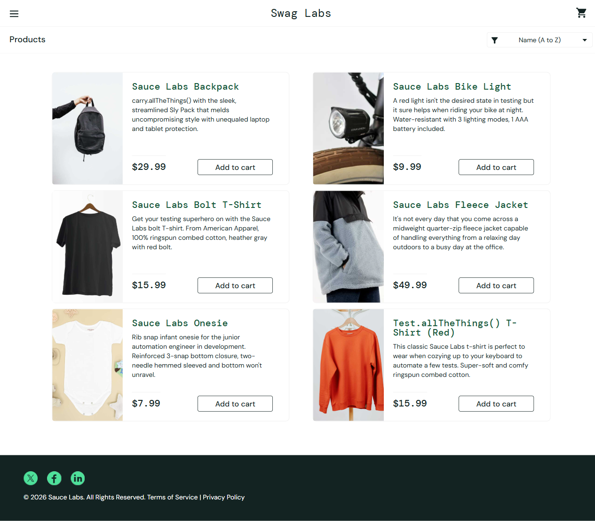
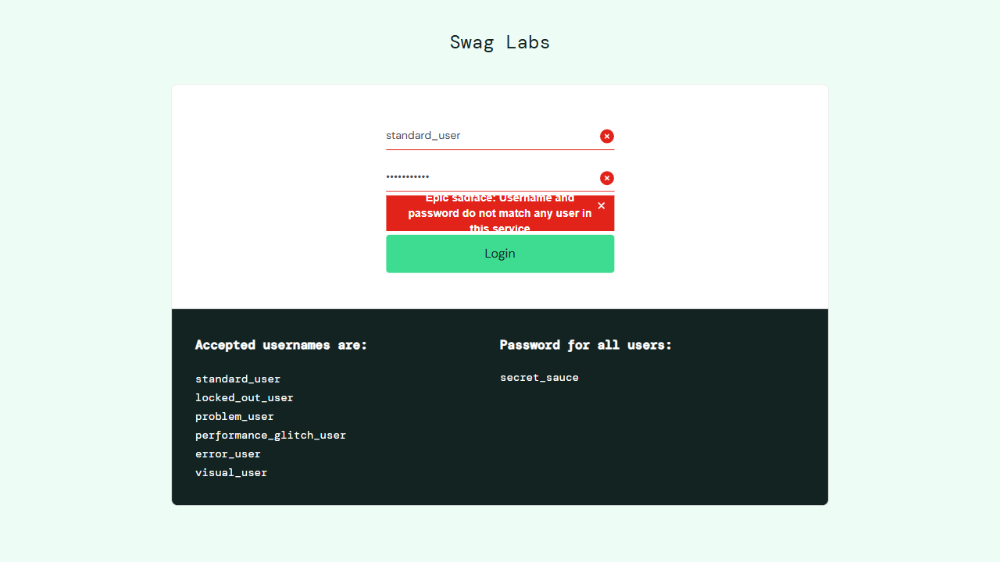
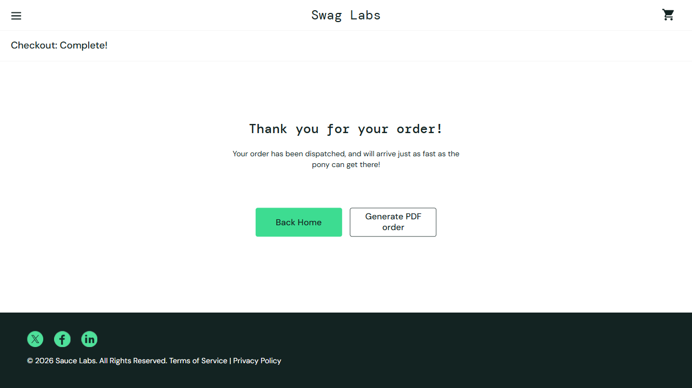

# Sauce Demo UI Automation Framework

UI test automation framework built using:

- C#
- Playwright
- NUnit
- Page Object Model (POM)
- Fluent Assertions

## Project Structure


- Pages
- Components
- Tests
- Utilities
- TestData


## Test Cases

### Login Tests
- Login with valid credentials
- Login with invalid password

### Inventory Tests
- Complete Order

## Design Pattern

This framework follows the Page Object Model (POM) design pattern to improve:

- Readability
- Maintainability
- Reusability

## Prerequisites

- .NET 10 SDK
- Visual Studio Code
- Playwright

## Test Execution Screenshots 

### Successful Login



### Invalid Login Error



### Successful Order Completion



## Installation

Clone repository:

```bash
git clone https://github.com/kevola1/SauceDemoAutomation.git
```

Navigate to the project:

```bash
cd SauceDemoAutomation
```

Install packages:

```bash
dotnet restore
```

Install Playwright browsers:

```bash
playwright install
```

Run tests:

```bash
dotnet test
```

## Author

Olaniyan Kevin 
kevinolaniyan@gmail.com